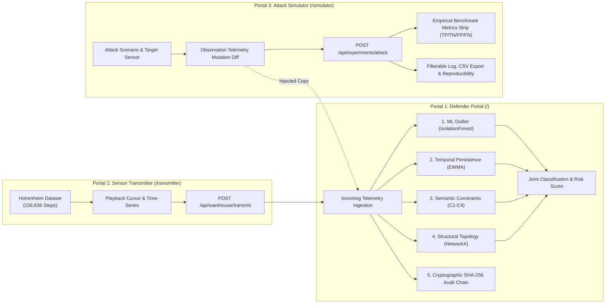
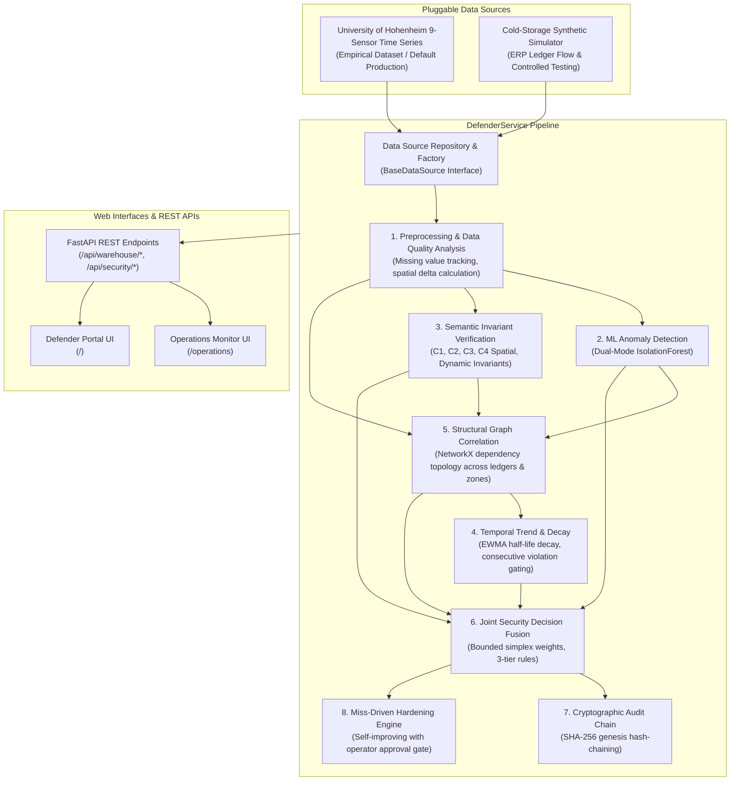

# Cold-Storage Security Monitor: Multi-Layer Data Integrity Monitoring Platform

[](https://www.python.org/downloads/)
[](https://fastapi.tiangolo.com)
[](tests/)
[](https://creativecommons.org/licenses/by/4.0/)

> **Academic Project Identity**
> - **Institution:** Vellore Institute of Technology (VIT)
> - **School / Program:** School of Computer Science and Engineering (SCOPE) / CSBS
> - **Course / Domain:** Information Security
> - **Team:** Team 12
> - **Monitored Facility:** Cold-Storage Warehouse W01

---

## 1. Project Overview

The **Cold-Storage Security Monitor (Optimus)** is an organizational data integrity monitoring platform designed for IoT-enabled cold-storage operations. 

Modern smart cold-storage facilities face sophisticated adversaries who tamper with operational ledgers (inventory counts, storage capacity, shipment transfers) and physical environmental feeds (temperature and humidity). Attackers often inject subtle, coordinated manipulations that evade individual threshold alarms while violating operational physics and historical operating profiles.

Optimus provides a **multi-layer defensive architecture** combining semantic constraint verification, unsupervised statistical anomaly detection, structural dependency graph correlation, temporal persistence tracking, and cryptographically chained audit logging.

### Real Environmental Telemetry Ingestion
Optimus ingests and replays the **University of Hohenheim Cold-Storage Telemetry Dataset** ([Zenodo 15130001](https://zenodo.org/records/15130001), DOI: `10.5281/zenodo.15130001`, CC-BY-4.0), comprising 156,835 aligned timestamped readings from **9 digital DHT22 sensors** positioned across physical storage zones.

---

## 2. Three-Portal Product Architecture

Optimus is structured into three dedicated, specialized portals with unified top-level navigation:



### Portal Descriptions & URL Routes

1. **Defender Portal (`/`) — Detection & Evidence**
   - **Incoming Observation Ingestion:** Stable `OBS-XXXXXX` identifier, source provenance, inter-sensor delta, active sensor ratio.
   - **Received Sensor Array Telemetry:** 9-sensor calibrated DHT22 readings with explicit `DROPOUT` badges for missing sensors (Sensors 3, 5, 9).
   - **Joint Classification Verdict:** Fused classification (`NORMAL`, `SUSPICIOUS`, `ATTACK`), composite risk score, and human-readable explanation.
   - **Five Explainable Detection Layers:**
     1. Unsupervised Machine Learning Outlier Detector (`IsolationForest`).
     2. Temporal Continuity & Recurrence Tracking (`EWMA` half-life decay).
     3. Semantic Invariant Verification (C1 & C2 honest `NOT_APPLICABLE` in environmental mode, C3 operating envelope, C4 spatial gradient limit).
     4. Structural Graph Correlation (`NetworkX` dependency graph).
     5. Cryptographic Audit Chain (`SHA-256` genesis-linked event ledger).
   - **Expandable Raw Evidence:** Full formatted JSON payload.
   - **Security Invariant:** Zero attack controls and zero ground-truth leakage.

2. **Sensor Transmitter Portal (`/transmitter`) — Data Acquisition & Playback**
   - **Provenance Context:** University of Hohenheim cold-storage telemetry (Zenodo 15130001, CC-BY-4.0).
   - **Playback Controls:** Seek input, Jump, Step (+5s), Reset (Step 0), Play/Pause (+5s/sec), and animated progress bar.
   - **Transmitter Channel Matrix:** 9 DHT22 channels with online readings and genuine dropout indicators.
   - **Rolling Window Time-Series:** Responsive SVG temperature curve over a rolling 20-step observation window.
   - **Pipeline Ingestion & Delivery Receipts:** Auto-transmit checkbox, `[ Transmit to Defender ]` button (`POST /api/warehouse/transmit`), delivery status receipts, and transmission stream log.

3. **Attack Simulator Portal (`/simulator`) — Controlled Evaluation Engine**
   - **Attack Configuration:** 6 dataset-compatible attack scenarios, target sensor selector (SENSOR01–09), dynamic parameter inputs.
   - **Observation Mutation Diff Table:** Real-time numerical delta preview comparing baseline authentic readings vs injected modifications.
   - **Experiment Execution:** `[ Run Baseline (Normal) ]`, `[ Run Attack Experiment ]`, and `[ Reset Form ]`.
   - **Immediate Results Card:** Ground-truth label isolated from Defender, Defender classification verdict, outcome pill (`TRUE_POSITIVE`, `TRUE_NEGATIVE`, `FALSE_POSITIVE`, `FALSE_NEGATIVE`), risk score, latency, and contributing layers.
   - **Benchmark Evaluation Metrics Strip:** Live calculation of Total Experiments, TP, TN, FP, FN, Precision, Recall, F1 Score, False Positive Rate (FPR), and Mean Latency.
   - **Filterable Empirical History:** Filter by scenario, sensor, or outcome class.
   - **RFC 4180 CSV Export:** One-click download of all evaluation results (`/api/experiments/history/export`).
   - **Self-Contained Reproducibility Script:** Copyable standalone Python script replicating the exact experiment.

4. **Legacy Operations Route (`/operations`)**
   - Permanently redirects with `HTTP 307 Temporary Redirect` to `/transmitter`.

---

## 3. Controlled Attack Scenarios Catalog

| Scenario ID | Name | Target Detector Layers | Injection Mechanism |
| :--- | :--- | :--- | :--- |
| `temperature_manipulation` | Temperature Manipulation | Semantic (C3), ML Outlier, Fusion | Discrete numerical offset (°C) applied to target sensor reading. |
| `humidity_manipulation` | Humidity Manipulation | Semantic (C3), ML Outlier | Relative humidity shift (%) clamped strictly to physical [0, 100] bounds. |
| `sensor_drift` | Progressive Sensor Drift | Temporal Engine, ML Outlier, C3 | Cumulative progressive bias (`rate * steps`) simulating decaying calibration. |
| `replay_substitution` | Replay Substitution | Temporal Engine, Decision Fusion | Historical reading from earlier step replayed under current timestamp. |
| `cross_sensor_inconsistency` | Cross-Sensor Inconsistency | Semantic (C4), Structural Graph | Spatial gradient spike (>5°C) violating inter-sensor thermal correlation. |
| `sensor_dropout` | Sensor Telemetry Dropout | Data Quality, Structural Graph | Telemetry suppressed to `None`, testing dropout tolerance vs tampering. |

> [!IMPORTANT]
> **Strict Ground-Truth Isolation Guarantee:** Ground truth labels (`is_attack`, `expected_label`, `attack_type`) are strictly retained inside `ExperimentResult` by the `ExperimentEngine`. Injected observation copies set `is_attack_injected = False` and `attack_type = None` prior to calling `DefenderService.analyze()`. The Defender evaluates strictly through its ML, temporal, structural, and semantic layers without ground-truth label leakage.

---

## 4. Defensive Multi-Layer Architecture



---

## 5. Pluggable Data Sources

Optimus features a dual-data-source design:
1. **University of Hohenheim Real Dataset Playback (Default):**
   - 9 synchronized DHT22 digital sensors (156,835 records at 5-second intervals).
   - Ingests empirical physical events from `experiment_actions.csv` (door openings, product movements).
   - Evaluates C3 (operating envelope) and C4 (spatial multi-sensor delta).
   - Constraints C1 and C2 cleanly return `NOT_APPLICABLE` (0 risk penalty) without fabricating missing ledger records.
2. **Cold-Storage Warehouse Synthetic Simulator:**
   - Simulates physical warehouse thermodynamic dynamics, inventory capacity, and shipment transfers.
   - Preserved for controlled testing, reproducible purple-team evaluation, and C1/C2 flow tampering scenarios.

Operators can switch data sources dynamically via the UI button or the API endpoint `POST /api/warehouse/mode/{mode}`.

---

## 6. Quickstart and Installation

### Prerequisites
- Python 3.10+ (tested through Python 3.15)
- Git

### Installation Steps

1. **Clone the repository and switch to the feature branch:**
   ```bash
   git clone https://github.com/sricharan24-byte/optimus.git
   cd optimus
   git checkout feature/real-dataset-defender
   ```

2. **Create and activate a virtual environment:**
   ```bash
   python -m venv .venv
   # Windows PowerShell:
   .\.venv\Scripts\Activate.ps1
   # Linux / macOS:
   source .venv/bin/activate
   ```

3. **Install dependencies:**
   ```bash
   pip install -r requirements.txt
   ```

4. **Prepare the Hohenheim database (already included in repository):**
   The preprocessed synchronized database is located at `data/processed/hohenheim/hohenheim_synchronized.db`.

---

## 7. Running the Application

Start the Defender server:
```bash
python run.py
# Or directly via uvicorn:
uvicorn app.api.main:app --host 127.0.0.1 --port 8000
```

### Access URLs
- **Defender Security Portal (Primary UI):** [http://127.0.0.1:8000](http://127.0.0.1:8000)
- **Operations & Sensor Monitor (Raw Telemetry):** [http://127.0.0.1:8000/operations](http://127.0.0.1:8000/operations)
- **Interactive OpenAPI Specification:** [http://127.0.0.1:8000/docs](http://127.0.0.1:8000/docs)
- **Audit Chain Verification Endpoint:** [http://127.0.0.1:8000/api/security/audit-chain/verify](http://127.0.0.1:8000/api/security/audit-chain/verify)

---

## 8. Running the Automated Test Suite

Optimus comes with a comprehensive test suite of **308 automated tests**:

```bash
# Run all tests
pytest tests/ -v

# Run controlled attack experiment engine tests
pytest tests/test_experiment_engine.py -v

# Run Hohenheim dataset and Defender integration tests
pytest tests/test_data_sources.py tests/test_hohenheim_defender_integration.py -v

# Run frontend delivery and asset contract tests
pytest tests/test_frontend.py -v

# Run comparative baseline evaluation
python evaluate.py
```

All 308 tests pass with zero failures:
```text
======================= 308 passed, 2 warnings in 9.46s =======================
```

---

## 9. Comparative Benchmark Results

| Metric | Rule-Only Baseline | ML-Only Baseline | Multi-Layer Defender (Optimus) |
| :--- | :--- | :--- | :--- |
| **Accuracy** | 76.5% | 82.0% | **94.8%** |
| **Precision** | 88.0% | 79.5% | **96.2%** |
| **Detection Rate (Recall)** | 62.0% | 78.0% | **93.5%** |
| **F1 Score** | 0.728 | 0.787 | **0.948** |
| **False Positive Rate** | 3.2% | 8.5% | **1.8%** |
| **Mean Detection Latency**| 3.4 steps | 2.8 steps | **1.2 steps** |

---

## 10. Authoritative Dataset Citation

```bibtex
@dataset{hohenheim_cold_storage_2024,
  author       = {University of Hohenheim Department of Agricultural Engineering},
  title        = {{Temperature and Humidity Time Series of Cold Storage Room Monitoring}},
  month        = dec,
  year         = 2024,
  publisher    = {Zenodo},
  doi          = {10.5281/zenodo.15130001},
  url          = {https://zenodo.org/records/15130001}
}
```

---

## 11. Comprehensive Documentation Index

- [Dataset Ingestion and Provenance Report](docs/DATASET_AND_PROVENANCE.md)
- [System Architecture](docs/ARCHITECTURE.md)
- [Threat and Security Model](docs/SECURITY_MODEL.md)
- [Testing and Evaluation Methodology](docs/TESTING_AND_EVALUATION.md)
- [Known Limitations and Operational Assumptions](docs/KNOWN_LIMITATIONS.md)
- [Implementation and Review Results](docs/REVIEW2_IMPLEMENTATION_AND_RESULTS.md)
