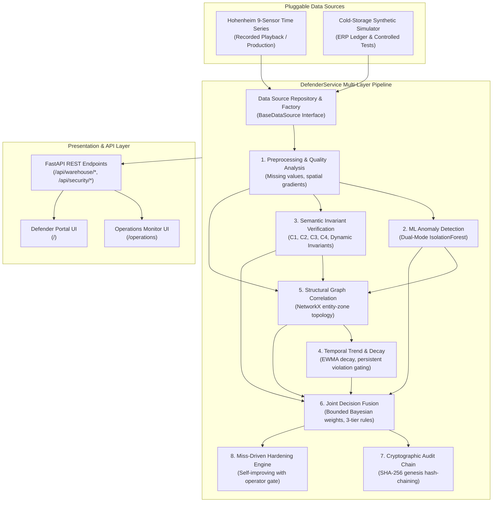

# Defender Platform Architecture

## 1. System Overview

The **Cold-Storage Security Monitor** is a multi-layer organizational data integrity monitoring platform designed for IoT-enabled cold-storage warehouse operations (Facility W01).

The platform continuously inspects operational records and physical environmental sensor feeds to detect tampering, sensor spoofing, coordinated manipulation, and uncoordinated stealth attacks.

---

## 2. Pluggable Data Source Architecture

The application abstracts observation generation through the `BaseDataSource` contract (`app/data_sources/base.py`):

1. **`HohenheimDataSource` (`app/data_sources/hohenheim.py`):**
   - Ingests empirical 9-sensor time series from `data/processed/hohenheim/hohenheim_synchronized.db`.
   - Supports deterministic stepping, seeking, reset, and sub-millisecond querying.
   - Provides full data quality metrics (`inter_sensor_temp_delta`, `spatial_temp_std`, active sensor counts).
   - Marks missing ledger fields cleanly as `None` without fabrication.

2. **`SimulatorDataSourceAdapter` (`app/data_sources/repository.py`):**
   - Wraps the existing `ColdStorageWarehouse` simulator into the `BaseDataSource` contract.
   - Preserved for controlled testing, ERP ledger consistency evaluation (C1/C2 attacks), and benchmark reproducibility.

3. **Runtime Switching:**
   - Operators can toggle modes at runtime via `POST /api/warehouse/mode/{mode}` or through `DATA_SOURCE_MODE` configuration.

---

## 3. Multi-Layer Detection Pipeline

### Layer 1: Semantic Invariant Verification
Enforces deterministic relational and physical invariants:
- **C1 (Capacity Consistency):** `inventory + free_capacity == total_capacity` ($\pm 0.5\text{t}$).
- **C2 (Inventory Flow Consistency):** $I_t == I_{t-1} + \text{inbound}_t - \text{outbound}_t$ ($\pm 0.2\text{t}$).
- **C3 (Historical Operating Envelope):** Evaluates temperature and humidity against facility envelopes:
  - University of Hohenheim cold room: $4^\circ\text{C}$ to $16^\circ\text{C}$ (mean $11.3^\circ\text{C}$).
  - Synthetic simulator cold storage: $1.0^\circ\text{C}$ to $7.0^\circ\text{C}$.
  - Door open transient awareness suppresses false alarms during documented physical access.
- **C4 (Spatial Sensor Consistency):** Evaluates multi-sensor gradient: $\max(T) - \min(T) \le 5.0^\circ\text{C}$.
- **Dynamic Mined Invariants:** Installed by the invariant miner (`app/defender/invariant_miner.py`) upon operator approval.

### Layer 2: Machine Learning Anomaly Detection
Uses scikit-learn `IsolationForest` operating in dual modes:
- **Operational Ledger Mode:** Analyzes multivariate interactions among `temperature`, `humidity`, `inventory`, `free_capacity`, `inbound`, `outbound`, and `occupancy`.
- **Environmental Spatial Mode:** Analyzes `temperature`, `humidity`, `inter_sensor_temp_delta`, `inter_sensor_hum_delta`, `spatial_temp_std`, and `active_sensor_ratio`.

### Layer 3: Structural Graph Correlation
Represents warehouse entities and physical zones as a NetworkX dependency graph:
- **Ledger Nodes:** `inventory_ledger`, `capacity_management`, `shipment_inbound`, `shipment_outbound`, `occupancy_sensor`.
- **Physical Nodes:** `ambient_zone`, `evaporator_zone`, `shelf_zone`, `perimeter_door`, `environmental_iot`.
- Calculates cross-subsystem correlation to detect multi-vector attacks spanning both administrative ledgers and physical sensors.

### Layer 4: Temporal Trend and Decay Tracking
Tracks temporal persistence and recurrence:
- Exponential weighted moving average (EWMA) decay with half-life parameter.
- Consecutive violation counting prevents transient blips from triggering emergency alerts while escalating sustained manipulation.

### Layer 5: Joint Security Decision Fusion
Combines layer outputs using bounded normalized weights:
$$w_{\text{semantic}} = 0.40, \quad w_{\text{ml}} = 0.25, \quad w_{\text{temporal}} = 0.20, \quad w_{\text{structural}} = 0.15$$
- **Rule Hierarchy:**
  - **Tier 1 (Hard Invariants):** Hard C1/C2 violations immediately flag `TAMPERING`.
  - **Tier 2 (Structural Compromise):** Multi-source correlations flag `MULTI_SOURCE` attack.
  - **Tier 3 (Composite Risk Score):** Evaluates normalized risk score $\in [0, 100]$:
    - $\ge 75.0$: `TAMPERING` (Critical)
    - $\ge 50.0$: `SUSPICIOUS` (Warning)
    - $< 50.0$: `NORMAL` (Operational)

---

## 4. Cryptographic Audit Chain

All security analysis results, operator actions, and hardening modifications are sealed into an in-memory SHA-256 hash chain:
- **Genesis Block:** `0000000000000000000000000000000000000000000000000000000000000000`
- **Hash Linkage:** $H_i = \text{SHA256}(H_{i-1} \parallel \text{event\_data})$
- **Verification Endpoint:** `GET /api/security/audit-chain/verify` validates chain integrity from genesis to tip.

---

## 5. Miss-Driven Hardening Engine

When undetected attacks (false negatives) or false positives occur, the hardening engine (`app/defender/hardening.py`):
1. Analyzes missed episodes and proposes bounded parameter adjustments.
2. Evaluates proposals against a validation benchmark to prevent regressions ($FPR \le 0.05$).
3. **Mandatory Human Approval Gate:** Hardening proposals cannot auto-activate; an authenticated operator must review and approve via `POST /api/security/hardening/proposals/{id}/approve`.
4. **Instant Rollback:** Operator can rollback changes at any time via `POST /api/security/hardening/rollback`.
