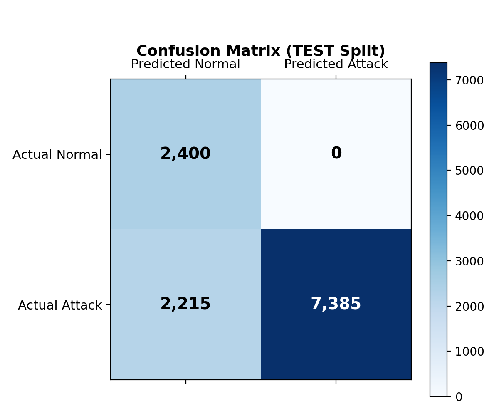
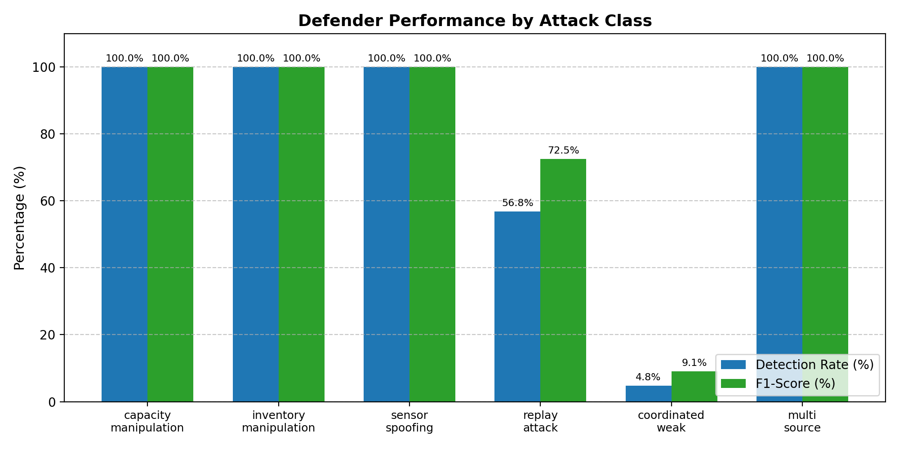
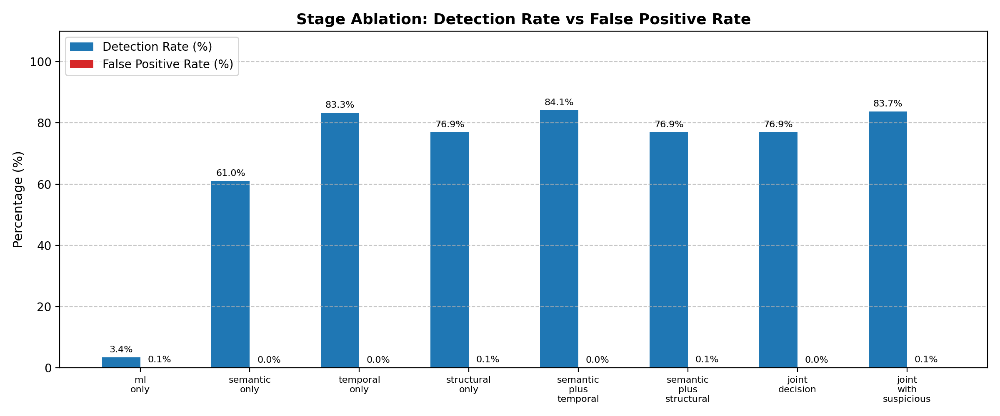
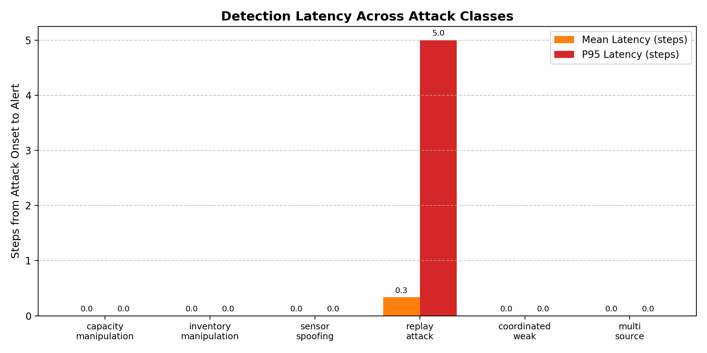
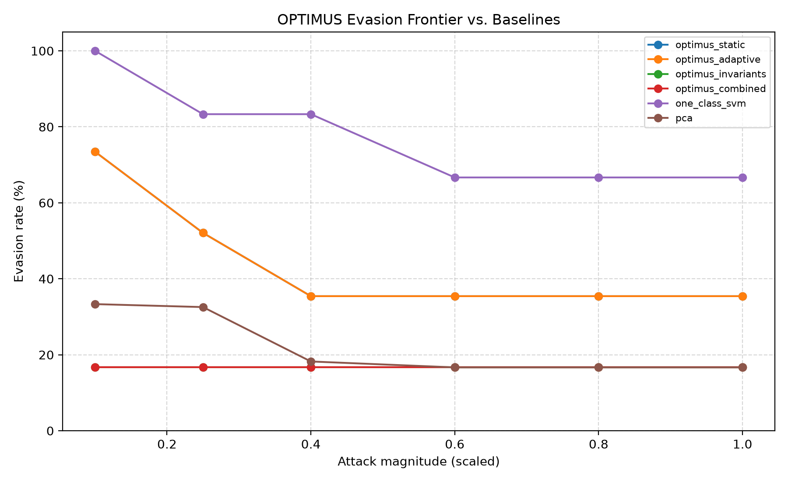
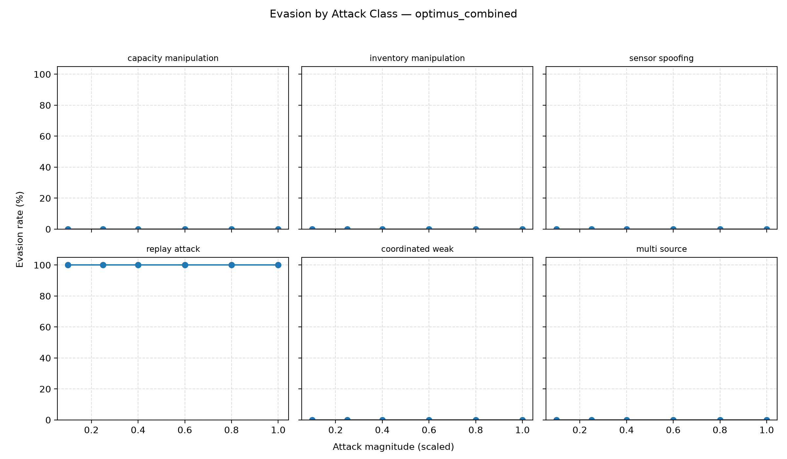

# OPTIMUS Review 2 — Implementation and Results

**Project:** Cold-Storage Warehouse Cybersecurity Monitoring & AI Attack Simulation Platform  
**Facility:** Simulated cold-storage warehouse W01  
**Report date:** 2026-10-20  
**Repository:** <https://github.com/durga-61/optimus-purple-team>  
**Branch / implementation commit:** `main` / `8a57aab`  
**Implementation status:** Advanced feature code, tests, evaluation artifacts, and this report are committed and pushed to `main`.

---

## 1. Working Implementation

The platform is a working two-part system:

- **Part 1 — Defender:** multi-layer monitoring pipeline for IoT telemetry, inventory, and shipment ledgers.
- **Part 2 — Attacker:** isolated attack-simulation console with human-in-the-loop approval and gateway enforcement.
- **Closed loop:** missed detections can become bounded, validated, operator-approved hardening proposals.
- **Audit:** SHA-256 hash-chained security events with tamper verification.

### 1.1 Detection pipeline

| Layer | Implementation | Purpose |
|---|---|---|
| ML anomaly detection | Isolation Forest | Statistical outlier detection over seven physical/operational features |
| Semantic verification | C1 capacity, C2 flow, C3 environmental bounds, plus approved mined invariants | Detect physically inconsistent records |
| Temporal tracking | Sliding-window persistence and decay | Detect recurring or escalating violations |
| Structural correlation | Graph blast-radius correlation | Detect cross-subsystem / multi-source compromise |
| Joint decision | Deterministic rule pathways + bounded weighted risk score | Produce final classification and risk score |

### 1.2 Advanced features added for Review 2

| Feature | Main implementation |
|---|---|
| Trusted-label adaptive fusion | `app/defender/adaptive_fusion.py`, `app/defender/decision.py` |
| Dynamic invariant miner | `app/defender/invariant_miner.py`, `app/defender/semantic.py` |
| One-Class SVM and PCA baselines | `app/evaluation/baselines.py` |
| Evasion frontier | `app/evaluation/evasion_frontier.py` |
| Advanced experiment orchestration | `app/evaluation/advanced_experiments.py`, `evaluate_advanced.py` |
| Reproducible splits and checksums | `app/evaluation/dataset.py`, `evaluation_results/dataset_manifest.json` |
| Audit/lifecycle verification | `evaluation_results/audit_lifecycle_verification.json` |

### 1.3 How to reproduce

```bash
# Full automated test suite
.venv/bin/python -m pytest tests/ -q

# Standard test-set evaluation
.venv/bin/python evaluate.py --split test --output-dir evaluation_results

# Baseline vs self-hardened comparison
.venv/bin/python evaluate_hardening.py

# Advanced experiments: adaptive fusion, invariants, baselines, frontier, audit
.venv/bin/python evaluate_advanced.py --output-dir evaluation_results
```

Verified test result: **274 passed, 1 warning**.

---

## 2. Dataset Preparation and Train/Test Split

### 2.1 Generation

- Random seed: **42**
- Normal observations: **12,000**
- Attack observations: **12,000** — six attack classes × **2,000** observations each
- Attack classes:
  - capacity manipulation
  - inventory manipulation
  - sensor spoofing
  - replay attack
  - coordinated weak manipulation
  - multi-source manipulation
- Ground-truth labels and attack metadata are scrubbed from the observation passed to the defender.
- Timestamps use a deterministic dataset epoch (`2026-01-01 UTC + step seconds`) so split files and hashes reproduce.

### 2.2 Strict temporal split

| Split | Records | Normal | Attack | Composition | SHA-256 |
|---|---:|---:|---:|---|---|
| Train | 7,200 | 7,200 | 0 | Normal only; used for ML fitting and invariant discovery | `d3acc0e816aa0181952b1063c17bc0d7528eeb239d958b5dfafcd125734a5824` |
| Validation | 4,800 | 2,400 | 2,400 | 400 attacks per class; used for threshold/weight/invariant validation | `bf245d682d47f8d1bbabfd00102899192c03fd0ac5b79040dd0f6063e313ebe0` |
| Test | 12,000 | 2,400 | 9,600 | 1,600 attacks per class; held out and scored once | `11ff544c47a509fbecc5653b2ae1ad141036fba909db112a163b9d369709e8d2` |

The exact split files are exported under `evaluation_results/datasets/`, with the manifest at `evaluation_results/dataset_manifest.json`.

### 2.3 Leakage controls

- Training data contains normal records only.
- Thresholds, adaptive weights, and invariant rules are fitted/validated on the validation split.
- The test split is used only for final scoring.
- Attack labels are never exposed to the defender pipeline.
- Split hashes reproduce across repeated exports.

---

## 3. Experimental Setup

### 3.1 Hardware

| Item | Value |
|---|---|
| CPU | Intel Core i5-1035G1 @ 1.00 GHz (4 cores / 8 threads, up to 3.60 GHz) |
| RAM | 6.8 GiB |
| Platform | Ubuntu 26.04.1 LTS, x86_64 |
| Kernel | 7.0.0-38-generic |
| GPU | None — CPU-only execution |

### 3.2 Software and libraries

| Component | Version |
|---|---|
| Python | 3.12.12 |
| scikit-learn | 1.9.1 |
| NumPy | 2.5.4 |
| pandas | 3.0.6 |
| SciPy | 1.18.1 |
| FastAPI | 0.154.0 |
| Pydantic | 2.14.1 |
| NetworkX | 3.7 |
| Matplotlib | 3.11.2 |
| pytest | 9.1.1 |

### 3.3 Key parameters

| Area | Parameter | Value |
|---|---|---|
| Warehouse | Total capacity | 50.0 t |
| Warehouse | Initial inventory | 42.0 t |
| Warehouse | Target temperature | 4.2 °C |
| Warehouse | Target humidity | 71.0% |
| Warehouse | Humidity bounds | 60–85% |
| Warehouse | Max shipment rate | 2.5 t/step |
| Warehouse | History buffer | 100 observations |
| Semantic | C1 capacity tolerance | 0.5 t |
| Semantic | C2 flow tolerance | 0.5 t |
| Semantic | C3 temperature bounds | 1.0–7.0 °C |
| ML | Isolation Forest estimators (train fit) | 100 |
| ML | Contamination | 0.03 |
| ML | Random state | 42 |
| ML | Anomaly threshold | 0.60 |
| Fusion | Static weights (semantic / temporal / structural / ML) | 0.40 / 0.25 / 0.20 / 0.15 |
| Adaptive fusion | Safety bounds | semantic 0.20–0.60; temporal 0.10–0.40; structural 0.10–0.40; ML 0.05–0.35 |
| Adaptive fusion | Validation FPR ceiling | 0.001 |
| Invariants | Minimum normal coverage | 0.999 |
| Invariants | Maximum FPR | 0.001 |
| Invariants | Minimum attack detection | 0.02 |
| Invariants | Redundancy Jaccard threshold | 0.95 |
| One-Class SVM | `nu`, kernel, gamma | 0.03, RBF, `scale` |
| PCA | Variance retained | 0.95 |
| Frontier | Attack strengths | 0.10, 0.25, 0.40, 0.60, 0.80, 1.00 |
| Frontier | Episodes per class × length | 8 × 8 |

### 3.4 Evaluation protocol

1. Fit the ML detector on the normal training split.
2. Calibrate thresholds and adaptive weights on the validation split under a hard FPR ceiling.
3. Discover invariant candidates on training normals; validate them on independent validation normals and attacks.
4. Fit One-Class SVM and PCA on normal training data only; calibrate on validation data.
5. Score the held-out test split once.
6. Run the separate scaled-attack evasion frontier with deterministic seeds.

---

## 4. Results

### 4.1 Overall held-out test performance

Test set: 2,400 normal observations and 9,600 attack observations.

| System | Accuracy | Precision | Recall | F1 | FPR | Evasion |
|---|---:|---:|---:|---:|---:|---:|
| OPTIMUS baseline | 0.8154 | 1.0000 | 0.7693 | 0.8696 | 0.0000 | 0.2307 |
| OPTIMUS + self-hardening | 0.9489 | 1.0000 | 0.9361 | 0.9670 | 0.0000 | 0.0639 |
| OPTIMUS + mined invariants | 0.9552 | 1.0000 | 0.9440 | 0.9712 | 0.0000 | 0.0560 |
| OPTIMUS + mined invariants + adaptive fusion | 0.9552 | 1.0000 | 0.9440 | 0.9712 | 0.0000 | 0.0560 |

**Confusion counts (baseline / hardened):**

| System | TP | FP | TN | FN |
|---|---:|---:|---:|---:|
| Baseline | 7,385 | 0 | 2,400 | 2,215 |
| Hardened | 8,987 | 0 | 2,400 | 613 |

The baseline achieves **99.17% episode detection** with **0.06-step mean detection latency**. Hardening improves observation-level recall by **+16.68 percentage points** without increasing the false-positive rate.

### 4.2 Per-attack-class recall

| Attack class | Baseline | Hardened | Mined invariants |
|---|---:|---:|---:|
| Capacity manipulation | 1.0000 | 1.0000 | 1.0000 |
| Inventory manipulation | 1.0000 | 1.0000 | 1.0000 |
| Sensor spoofing | 1.0000 | 1.0000 | 1.0000 |
| Replay attack | 0.5681 | 0.6169 | 0.6637 |
| Coordinated weak | 0.0475 | 1.0000 | 1.0000 |
| Multi-source | 1.0000 | 1.0000 | 1.0000 |

The main baseline weakness is **coordinated weak manipulation** (4.75% recall). Self-hardening and mined invariants both close that gap. Replay remains the hardest class because stationary, in-envelope replay is not observable from passive telemetry alone.

### 4.3 Ablation study

| Configuration | Detection rate | FPR | Precision | Recall | F1 | Accuracy |
|---|---:|---:|---:|---:|---:|---:|
| ML only | 0.0344 | 0.0013 | 0.9910 | 0.0344 | 0.0664 | 0.2273 |
| Semantic only | 0.6101 | 0.0000 | 1.0000 | 0.6101 | 0.7578 | 0.6881 |
| Temporal only | 0.8326 | 0.0000 | 1.0000 | 0.8326 | 0.9087 | 0.8661 |
| Structural only | 0.7693 | 0.0013 | 0.9996 | 0.7693 | 0.8694 | 0.8152 |
| Semantic + temporal | 0.8407 | 0.0000 | 1.0000 | 0.8407 | 0.9135 | 0.8726 |
| Semantic + structural | 0.7693 | 0.0013 | 0.9996 | 0.7693 | 0.8694 | 0.8152 |
| Joint decision | 0.7693 | 0.0000 | 1.0000 | 0.7693 | 0.8696 | 0.8154 |
| Joint + suspicious triage | 0.8372 | 0.0013 | 0.9996 | 0.8372 | 0.9112 | 0.8695 |

The ablation confirms that no single layer is sufficient: ML-only recall is only **3.44%**, while the joint decision reaches **76.93%** at zero FPR.

### 4.4 Adaptive fusion experiment

Adaptive weights were learned only from trusted validation labels, under a hard validation FPR ceiling of **0.001**.

| Weight | Static | Adapted | Safety bounds |
|---|---:|---:|---|
| Semantic | 0.40000000 | 0.49092757 | 0.20–0.60 |
| Temporal | 0.25000000 | 0.11031382 | 0.10–0.40 |
| Structural | 0.20000000 | 0.34875861 | 0.10–0.40 |
| ML | 0.15000000 | 0.05000000 | 0.05–0.35 |

| Validation criterion | Static | Adaptive |
|---|---:|---:|
| F1 | 0.866981 | 0.867390 |
| Recall | 0.765833 | 0.765833 |
| Precision | 0.998913 | 1.000000 |
| FPR | 0.000833 | 0.000000 |

| Held-out test criterion | Static | Adaptive |
|---|---:|---:|
| Rule classification recall | 0.7693 | 0.7693 |
| Rule classification F1 | 0.8696 | 0.8696 |
| Risk-threshold recall | 0.7691 | 0.7689 |
| Risk-threshold F1 | 0.8695 | 0.8693 |
| Mean risk score | 0.3985 | 0.3703 |

**Honest result:** the adapted vector was adopted on validation, but it did **not** improve held-out rule classification and was marginally worse under the risk-threshold criterion. This is expected: deterministic rule paths are driven by semantic evidence and thresholds, not by the weighted risk score. The static weights are retained if adaptation does not improve validation performance.

### 4.5 Dynamic invariant mining

The miner discovered **9** candidates, validated/activated **8**, and rejected **1**.

| Candidate | Kind | Tolerance | Validation coverage | Attack detection | FPR | Status |
|---|---|---:|---:|---:|---:|---|
| INV-CAPACITY-RESIDUAL | residual / capacity | 0.100 | 1.000000 | 0.666250 | 0.000000 | ACTIVE |
| INV-FLOW-RESIDUAL | residual / flow | 0.100 | 1.000000 | 0.434583 | 0.000000 | ACTIVE |
| INV-OCCUPANCY-IDENTITY | residual / occupancy | 0.250 | 1.000000 | 0.416667 | 0.000000 | ACTIVE |
| INV-TEMP-ENVELOPE | envelope / temperature | 0.000 | 1.000000 | 0.275000 | 0.000000 | ACTIVE |
| INV-HUMIDITY-ENVELOPE | envelope / humidity | 0.000 | 0.999583 | 0.108333 | 0.000417 | ACTIVE |
| INV-TEMP-SLEW | slew / temperature | 0.247 | 1.000000 | 0.183750 | 0.000000 | ACTIVE |
| INV-HUMIDITY-SLEW | slew / humidity | 0.949 | 1.000000 | 0.184167 | 0.000000 | ACTIVE |
| INV-INVENTORY-SLEW | slew / inventory | 3.211 | 1.000000 | 0.204167 | 0.000000 | ACTIVE |
| INV-SHIPMENT-RATE | rate / shipment | 2.625 | 1.000000 | 0.000000 | 0.000000 | REJECTED — no attack discrimination |

On the held-out test split, mined invariants improve recall from **76.93%** to **94.40%** and F1 from **0.8696** to **0.9712**, with FPR unchanged at **0**. The combined system has the same rule classification metrics because adaptive weights do not alter rule labels; its mean risk score changes from 0.5024 to 0.4704.

### 4.6 Baseline comparison

The comparison uses two standard unsupervised anomaly-detection methods from the literature survey: **One-Class SVM** and **PCA reconstruction error**. Both use the same seven features, are fitted on normal training data only, calibrated on validation data under FPR ≤ 0.001, and scored on the same held-out test split.

| Detector | Accuracy | Precision | Recall | F1 | FPR | Evasion |
|---|---:|---:|---:|---:|---:|---:|
| OPTIMUS baseline | 0.8154 | 1.0000 | 0.7693 | 0.8696 | 0.0000 | 0.2307 |
| One-Class SVM | 0.4667 | 1.0000 | 0.3333 | 0.5000 | 0.0000 | 0.6667 |
| PCA | 0.7999 | 1.0000 | 0.7499 | 0.8571 | 0.0000 | 0.2501 |

Per-class behavior explains the gap:

- **One-Class SVM** detects sensor spoofing and multi-source attacks, but misses capacity manipulation, inventory manipulation, replay, and coordinated weak manipulation.
- **PCA** detects coordinated weak, inventory, multi-source, and sensor attacks, but completely misses replay and detects only 50% of capacity manipulation.
- **OPTIMUS** combines semantic invariants, temporal persistence, and structural correlation, giving higher recall and F1 than either baseline.

### 4.7 Figures













---

## 5. Security Evaluation

### 5.1 Attack simulation and resistance testing

The attacker application is isolated from the defender and interacts only through the gateway. It requires explicit human approval before executing a proposal; programmatic bypass is rejected. The automated suite covers the attacker workflow, gateway token checks, rate limiting, attack matrix, and API boundaries.

Six attack classes are simulated:

- capacity manipulation
- inventory manipulation
- sensor spoofing
- replay attack
- coordinated weak manipulation
- multi-source manipulation

The standard test split contains 9,600 attack observations. The per-class results in §4.2 show that the baseline detects four classes perfectly, struggles with replay (56.81%), and almost entirely misses coordinated weak manipulation (4.75%). Hardening and invariant mining repair the coordinated-weak gap.

### 5.2 Self-hardening results

The hardening run recorded **3 misses** (2 replay, 1 coordinated weak) and applied **2 validated, operator-approved proposals**:

| Proposal | Target | Change | Validation result |
|---|---|---|---|
| PROP-2500EF73 | C2 flow tolerance | 0.50 t → 0.25 t | Recall 0.7658 → 0.7775; F1 0.8674 → 0.8748; FPR 0 |
| PROP-4F427DB0 | C1 capacity tolerance | 0.50 t → 0.40 t | Recall 0.7775 → 0.9363; F1 0.8748 → 0.9671; FPR 0 |

Held-out effect:

- Recall: **76.93% → 93.61%** (+16.68 pp)
- F1: **86.96% → 96.70%** (+9.74 pp)
- Accuracy: **81.54% → 94.89%** (+13.35 pp)
- FPR: **0.00% → 0.00%**
- Coordinated weak recall: **4.75% → 100.00%**
- Replay recall: **56.81% → 61.69%**

### 5.3 Evasion frontier

Attack magnitude was swept from **0.10** to **1.00** across all six classes. Lower evasion is better.

| Configuration | Mean evasion across strengths | Evasion at full strength |
|---|---:|---:|
| OPTIMUS static | 0.4453 | 0.3542 |
| OPTIMUS adaptive | 0.4453 | 0.3542 |
| OPTIMUS + mined invariants | 0.1667 | 0.1667 |
| OPTIMUS combined | 0.1667 | 0.1667 |
| One-Class SVM | 0.7778 | 0.6667 |
| PCA | 0.2235 | 0.1667 |

**Evasion at full attack strength, by class (lower is better):**

| Attack class | OPTIMUS static | OPTIMUS combined | One-Class SVM | PCA |
|---|---:|---:|---:|---:|
| Capacity manipulation | 0.0% | 0.0% | 100.0% | 0.0% |
| Inventory manipulation | 0.0% | 0.0% | 100.0% | 0.0% |
| Sensor spoofing | 12.5% | 0.0% | 0.0% | 0.0% |
| Replay attack | 100.0% | 100.0% | 100.0% | 100.0% |
| Coordinated weak | 100.0% | 0.0% | 100.0% | 0.0% |
| Multi-source | 0.0% | 0.0% | 0.0% | 0.0% |
| **All classes** | **35.4%** | **16.7%** | **66.7%** | **16.7%** |

**Key security finding:** mined invariants roughly halve mean evasion relative to the static detector (44.53% → 16.67%) and eliminate coordinated-weak evasion at all tested strengths. Replay remains 100% evasive at full strength for every detector; resolving that requires cryptographic freshness (monotonic counters, edge HMACs, nonces), not passive telemetry analysis.

### 5.4 Audit chain and lifecycle verification

The audit-lifecycle check exercised the full path: miss → proposal → rejection/approval → activation → rollback.

| Check | Result |
|---|---|
| Audit chain valid | Yes |
| Audit events | 13 |
| Unauthorized activation blocked | Yes |
| Rejected proposal logged | Yes |
| Full lifecycle present | Yes |
| Rollback restored baseline parameters | Yes (`c1_tolerance` restored to 0.5) |
| Tampered event detected | Yes — `HASH_MISMATCH` |

### 5.5 Performance overhead

Latency was measured over the 12,000-sample held-out test set with paired baseline/hardened execution.

| Metric | Baseline | Hardened | Delta |
|---|---:|---:|---:|
| Mean latency | 8.189 ms | 8.242 ms | **+0.053 ms (+0.65%)** |
| Median latency | 7.939 ms | 7.962 ms | +0.023 ms |
| P95 latency | 9.662 ms | 9.730 ms | +0.068 ms |
| P99 latency | 11.516 ms | 11.606 ms | +0.090 ms |

The hardened security configuration adds approximately **0.05 ms mean overhead per observation** on this host, with no change in FPR. Prior component-level profiling on the original host showed that the ML layer dominates pipeline time (about 93%), while the semantic, temporal, structural, and decision layers are comparatively small. Memory is bounded by fixed-size history buffers; a prior verification on the original host measured approximately 180.9 MB RSS with +2.40 MB growth over 1,000 observations, but RSS was not re-measured in this canonical run.

---

## 6. Limitations and Honest Findings

1. **Adaptive fusion has limited effect.** It is offline, trusted-label adaptation, not online learning from live traffic or attacker feedback. On the canonical benchmark it did not improve rule classification and was marginally worse under the risk-threshold criterion.
2. **Replay attacks remain a passive-monitoring limitation.** Replay is 100% evasive at full strength. Detecting stationary, in-envelope replay requires cryptographic freshness rather than statistical anomaly detection.
3. **Mined invariants are statistical hypotheses.** They improved held-out recall, but require domain review, independent data, approval, and rollback readiness before production use.
4. **The audit chain is in-memory.** It provides runtime tamper evidence but does not survive process restart; production deployment needs append-only external storage.
5. **Baselines are not tuned production detectors.** One-Class SVM and PCA are standard literature baselines, not optimized competitors.
6. **The data is simulated.** The warehouse telemetry is generated by a deterministic simulator; results should be interpreted within that domain.

---

## 7. Reproducibility and Artifact Index

### 7.1 Verification status

- Automated tests: **274 passed, 1 warning**
- Checksummed artifacts: **28**
- Checksum mismatches: **0**
- Split hashes reproduce across repeated exports
- Test labels are not used for fitting, calibration, or invariant validation; only validation labels are used for those steps

### 7.2 Artifact index

| Artifact | Purpose |
|---|---|
| `evaluation_results/datasets/train.jsonl` | Normal-only training split |
| `evaluation_results/datasets/val.jsonl` | Validation split |
| `evaluation_results/datasets/test.jsonl` | Held-out test split |
| `evaluation_results/dataset_manifest.json` | Split sizes, class counts, SHA-256 digests |
| `evaluation_results/benchmark_summary.csv` | Overall baseline test metrics |
| `evaluation_results/per_class_metrics.csv` | Per-attack-class baseline metrics |
| `evaluation_results/ablation_metrics.csv` | Layer/configuration ablation |
| `evaluation_results/hardening_comparison.json/.csv` | Baseline vs hardened metrics and latency |
| `evaluation_results/adaptive_fusion_comparison.json/.csv` | Static vs adaptive weights and thresholds |
| `evaluation_results/invariant_mining_experiment.json` | Invariant candidates and comparisons |
| `evaluation_results/invariant_candidates.csv` | Candidate validation/rejection details |
| `evaluation_results/invariant_mining_comparison.csv` | Static vs invariants vs combined metrics |
| `evaluation_results/baseline_comparison.json/.csv` | OPTIMUS vs One-Class SVM vs PCA |
| `evaluation_results/evasion_frontier.json/.csv` | Full strength/class evasion data |
| `evaluation_results/evasion_frontier.png` | Overall evasion frontier chart |
| `evaluation_results/evasion_frontier_by_class.png` | Per-class evasion chart |
| `evaluation_results/audit_lifecycle_verification.json` | Audit-chain and lifecycle evidence |
| `evaluation_results/ADVANCED_RESULTS.md` | Concise advanced-results summary |
| `evaluation_results/artifacts_checksums.json` | SHA-256 checksums for every exported artifact |
| `docs/REVIEW2_IMPLEMENTATION_AND_RESULTS.md` | This report |

---

## 8. Review 2 Requirements Checklist

| Review 2 requirement | Where addressed | Evidence |
|---|---|---|
| Working implementation with GitHub link or Colab notebook | §1 | Repository link; working pipeline; 274 tests pass |
| Final dataset preparation and train/test split | §2 | 24,000 observations; strict 60/20/20 temporal split; SHA-256 manifest |
| Experimental setup: tools, libraries, parameters, hardware | §3 | Hardware/software tables; detector, fusion, invariant, and baseline parameters |
| Results with tables and graphs | §4 | Accuracy, precision, recall, F1, FPR, per-class recall, ablation, six figures |
| Comparison against at least one baseline or existing method | §4.6 | One-Class SVM and PCA on the same held-out test split |
| Security evaluation: attack simulation/resistance testing | §5.1–§5.4 | Six attack classes, self-hardening, evasion frontier, audit lifecycle |
| Performance overhead of the security component | §5.5 | +0.053 ms mean latency (+0.65%) with unchanged FPR |

---

## 9. Conclusion

The OPTIMUS implementation satisfies the Review 2 implementation-and-results requirements:

- It is a working, reproducible system with a public GitHub repository and a passing automated test suite.
- The final dataset is deterministic, leakage-controlled, temporally split, and hash-verifiable.
- The experimental setup is documented with hardware, software, parameters, and commands.
- The results include standard classification metrics, per-class security metrics, ablation, and visualizations.
- The system outperforms standard One-Class SVM and PCA baselines on held-out recall and F1.
- Security resistance is evaluated through six attack classes, self-hardening, an evasion frontier, and a tamper-evident audit lifecycle.
- The security overhead is small: approximately **0.05 ms** mean latency increase with no FPR increase.

The main honest caveats are the limited benefit of offline adaptive fusion, the unresolved replay-attack limitation, the statistical nature of mined invariants, and the in-memory audit chain.
